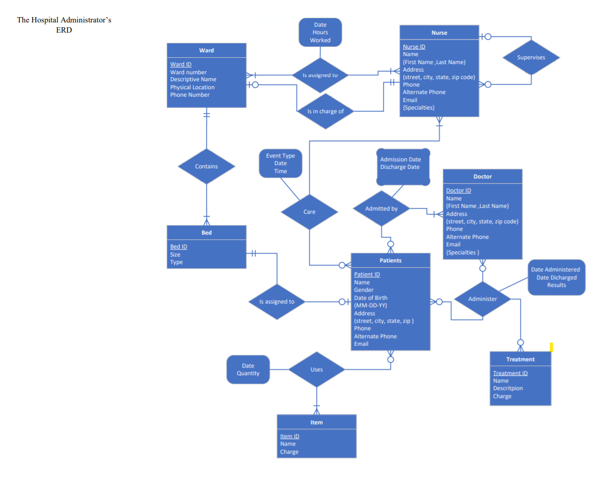
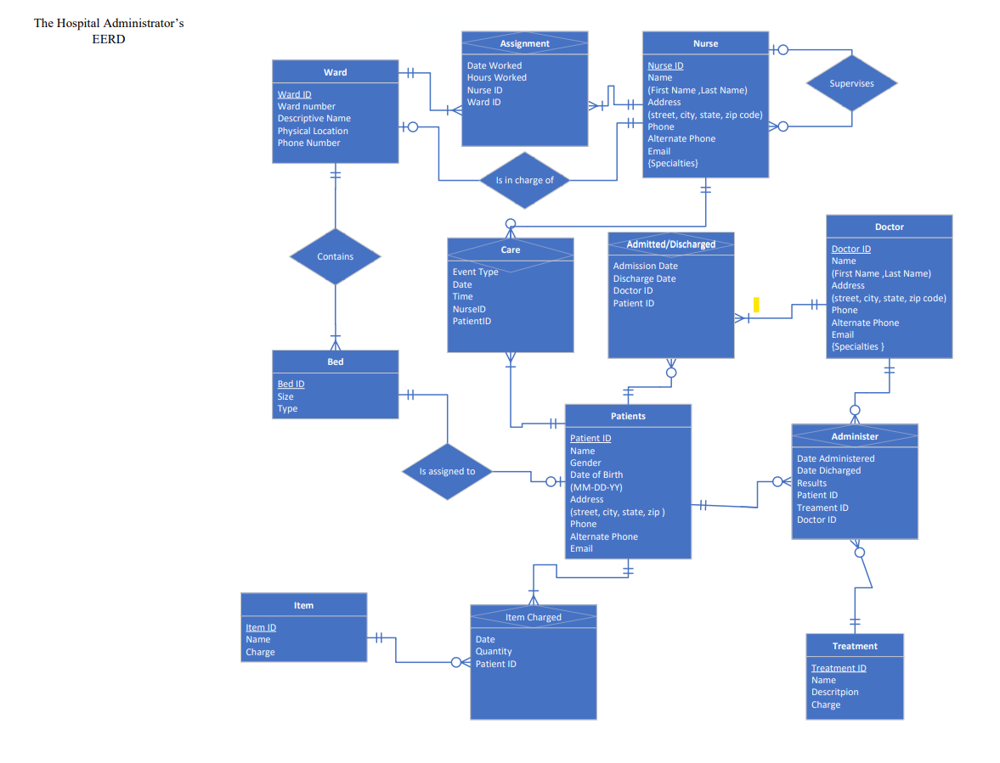

# Hospital Database System Design

## Overview
This project models a relational database system to support hospital operations including patient admissions, nurse assignments, treatments, bed management, and billing.

The system translates real-world hospital workflows into structured relational schemas using ERD/EERD modeling and normalization principles.

---

## What the database covers
- **Patients & admissions**: patient records linked to their assigned bed and ward
- **Beds & wards**: bed size, type (medical/emergency), and live availability
- **Staff**: nurse assignments to patients and wards
- **Treatments & billing**: treatments given and itemized charges per stay

## Skills shown
Entity-relationship modeling (ERD + EERD with specialization), normalization to 3NF, relational schema design, and SQL reporting with joins and aggregations (SQL Server / T-SQL).

## Project Structure
- **assets/** → ERD and EERD diagrams  
- **docs/** → Full project documentation (data dictionary and design write-up)  
- **sql/** → SQL scripts and reporting queries  

---

## ERD Preview

### ERD

### EERD

---

## SQL Implementation
Sample queries are available in:
- `sql/04_sample_queries.sql`

---

## Author
Preciosa Muujiza Ngoy Kalumba  
M.S. Artificial Intelligence & Business Analytics — University of South Florida
